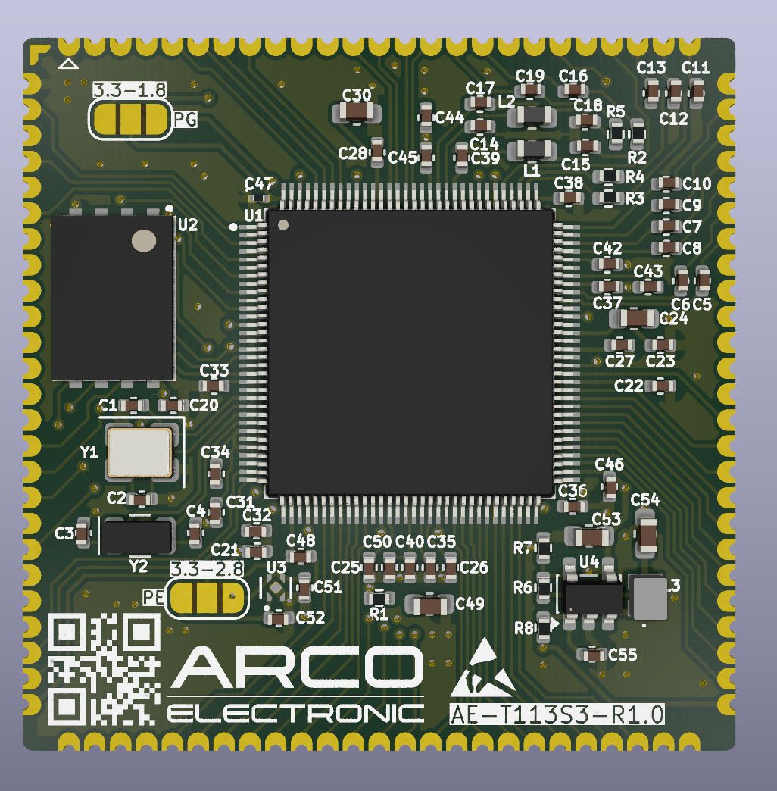
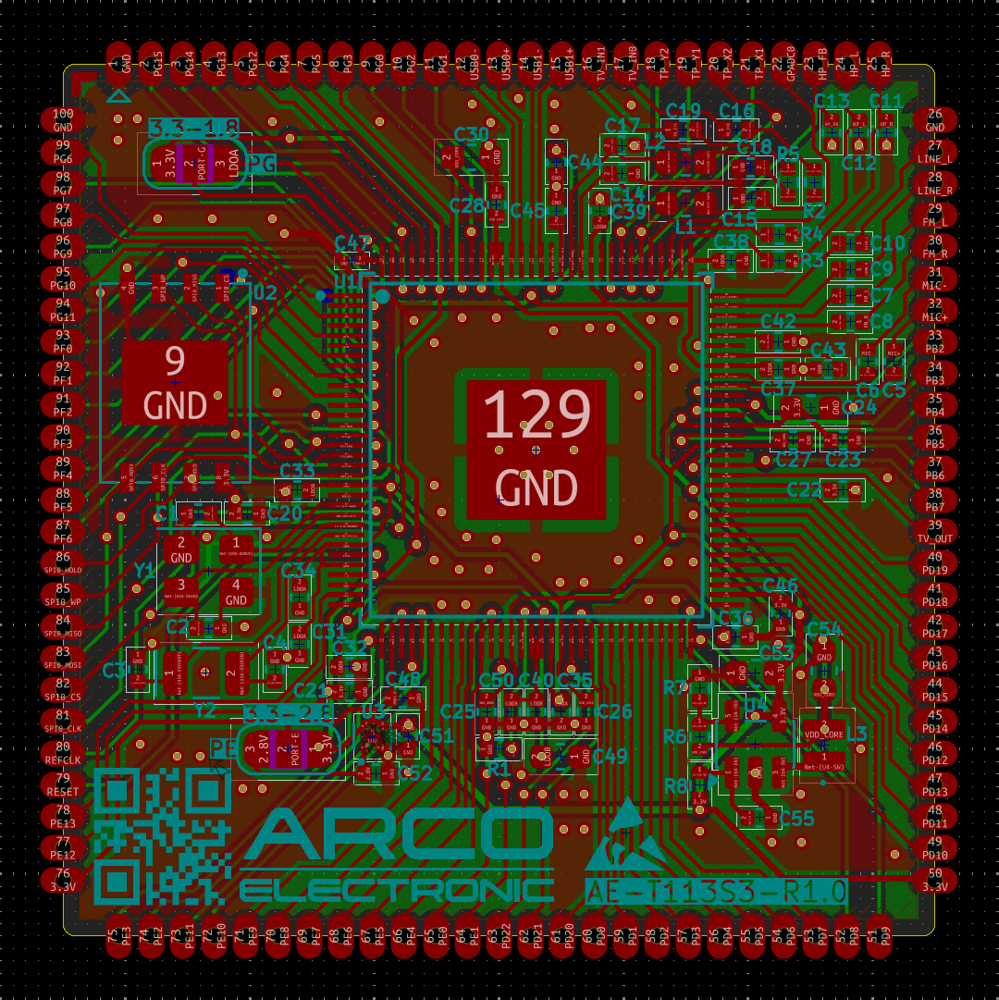

# AE-T113S3-CORE

A custom **Allwinner T113-S3 core board** designed to solder onto a carrier PCB. Revision **R1.0** uses a **35 × 35 mm** footprint with **100 castellated pads** around its four edges.

## Hardware at a glance

| Feature | Details |
| --- | --- |
| Processor | Allwinner T113-S3 |
| Storage | 256 MB NAND flash |
| Module footprint | 35 × 35 mm, 100 castellated pads |
| Carrier connections | GPIO, USB, SPI0, audio, TV out, reset, reference clock, 3.3 V and ground |
| I/O voltage selection | Solder jumpers marked **PG** (3.3 V / 1.8 V) and **PE** (3.3 V / 2.8 V) |

## Design files

| File | Contents |
| --- | --- |
| [KiCad project](T113-S3_Core_V1/T113-S3_Core_V1/T113-S3_Core_V1.kicad_pro) | Open this project to browse the schematic and PCB layout. |
| [Schematic](T113-S3_Core_V1/T113-S3_Core_V1/T113-S3_Core_V1.kicad_sch) | Circuit design and signal assignments. |
| [PCB layout](T113-S3_Core_V1/T113-S3_Core_V1/T113-S3_Core_V1.kicad_pcb) | Board outline, component placement, routing, and numbered pads. |
| [KiCad libraries](libraries/) | Custom symbols, footprints, and 3D models. |
| [Fabrication archive](T113-S3_Core_V1/T113-S3_Core_V1_FAB.zip) | Gerber and drill files. [Browse the unpacked files](T113-S3_Core_V1/T113-S3_Core_V1_FAB/). |

## Carrier board integration

Start with the [100-pad carrier landing footprint](libraries/footprints.pretty/Carrier_Landing_35x35_100P.kicad_mod) in the repository. Use the schematic and PCB layout to check pad numbering, the pin 1 orientation, and the PG and PE voltage selections against your carrier design.

## PCB routing and pad labels

Click the layout image to open it at full resolution.
